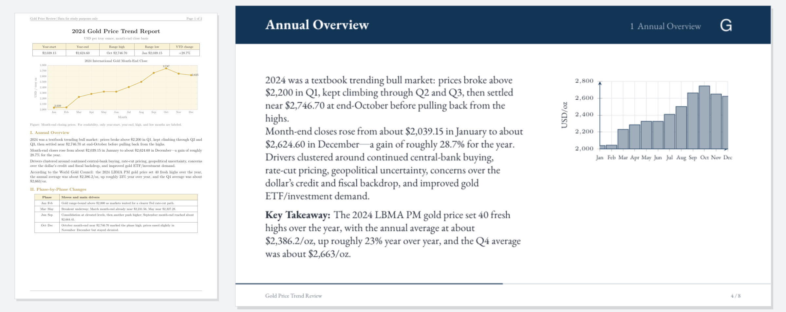
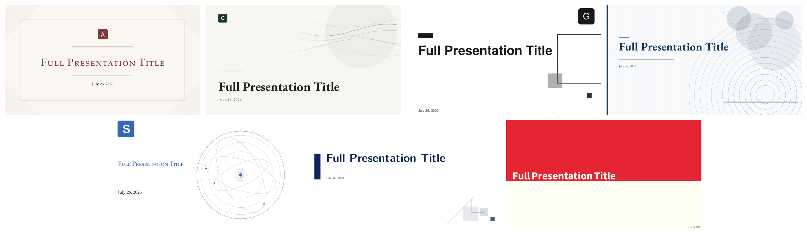

English | [简体中文](README.zh-CN.md)

# TeXDeck

<p align="center">
  
</p>

Drop in a PDF, get back a Beamer deck: the compiled PDF, the `.tex` source, and a zip that opens in Overleaf.

<p align="center">
  
</p>

A vision model reads your pages as images and writes a complete `main.tex` against the template you pick. It takes about a minute. You can then rewrite one slide, or the whole deck, with a single instruction. The source on the left is [`docs/demo/gold-price-2024.pdf`](docs/demo/gold-price-2024.pdf), so you can try it yourself.

**No API key needed:** it runs on the ChatGPT or Claude subscription you already pay for. An API key works too.

## Install

**Desktop app.** Download it from [Releases](https://github.com/HuanPP/TeXDeck/releases) (macOS Apple silicon, Windows, Linux). It bundles its own TeX engine, so you don't need a TeX install. The builds are unsigned: on macOS, right-click the app and choose Open; on Windows, choose More info, then Run anyway.

**Docker.**

```bash
git clone https://github.com/HuanPP/TeXDeck.git && cd TeXDeck
docker compose up --build        # then open http://localhost:8000
```

**From source.** You need Python 3.12+, Node 20+, and XeLaTeX or [Tectonic](https://tectonic-typesetting.github.io).

```bash
uv venv .venv --python 3.12 && uv pip install -e server --python .venv/bin/python
cp server/.env.example server/.env && ./server/run.sh     # API on :8000
cd web && npm install && npm run dev                      # UI on :5173
```

## Pick a model

There are three ways to pay for the model. Two of them use a subscription you already have. Settings go in `.env`, or in `texdeck.env` in the desktop app's data folder.

**ChatGPT subscription.** Click **Sign in with ChatGPT** in the top bar. Nothing else to set.

**Claude subscription, through Claude Code.** See [below](#claude-subscription-via-claude-code).

**API key.** Any OpenAI-compatible vision model:

```bash
TEXDECK_LLM_API_KEY=...
TEXDECK_LLM_BASE_URL=https://generativelanguage.googleapis.com/v1beta/openai/
TEXDECK_LLM_MODEL=gemini-pro-latest      # recommended; Kimi vision models also work
```

Text-only models won't work, because pages are sent as images.

### Claude subscription via Claude Code

TeXDeck starts your own `claude` CLI in headless mode (`claude -p`, no tools, CLAUDE.md and plugins off), so generation runs on whatever account that CLI is signed in with. TeXDeck never sees the credentials. Install Claude Code and sign in with `claude auth login` (your Claude subscription is the default; check with `claude auth status`; an `ANTHROPIC_API_KEY` in the environment switches the CLI to API billing), then:

```bash
TEXDECK_LLM_PROVIDER=claude-code
TEXDECK_CLAUDE_CODE_MODEL=sonnet         # or opus, or a full model name
```

This needs the CLI on the machine running TeXDeck, so it works from source and in the desktop app but not in the Docker image.

## Templates

<p align="center">
  
</p>

The bundle has seven templates: Academic, Emerald, Graphite, Navy, Scholar, SimplePlus and Execushares. All of them handle Chinese. Licenses are listed in [NOTICE](NOTICE).

There is no prompt library. Each template's `main.tex` is a complete example deck, and the model copies it. To make your own, copy `templates/academic`, change `key` and `name` in `template.json`, and edit `main.tex`. Real charts in the example mean real charts in the output.

## Good to know

If the model writes TeX that won't compile even after the automatic repair pass, the job fails and shows the real log. You never get a half-broken deck. Press Regenerate and it usually works. Slide counts are approximate. Input is limited to 10 PDFs and 200 pages in total.

```bash
cd server && ../.venv/bin/python -m pytest      # includes a real compile of every template
python desktop/build.py                         # build the desktop app for this machine
```

## License

The application code is MIT. Bundled themes keep their own licenses; see [NOTICE](NOTICE).
