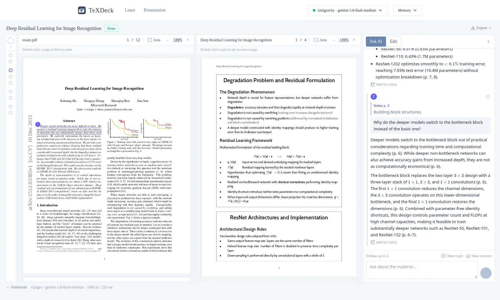
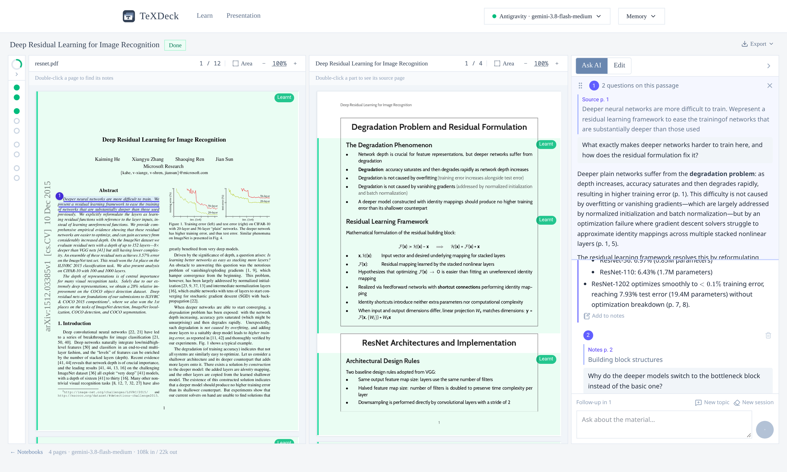
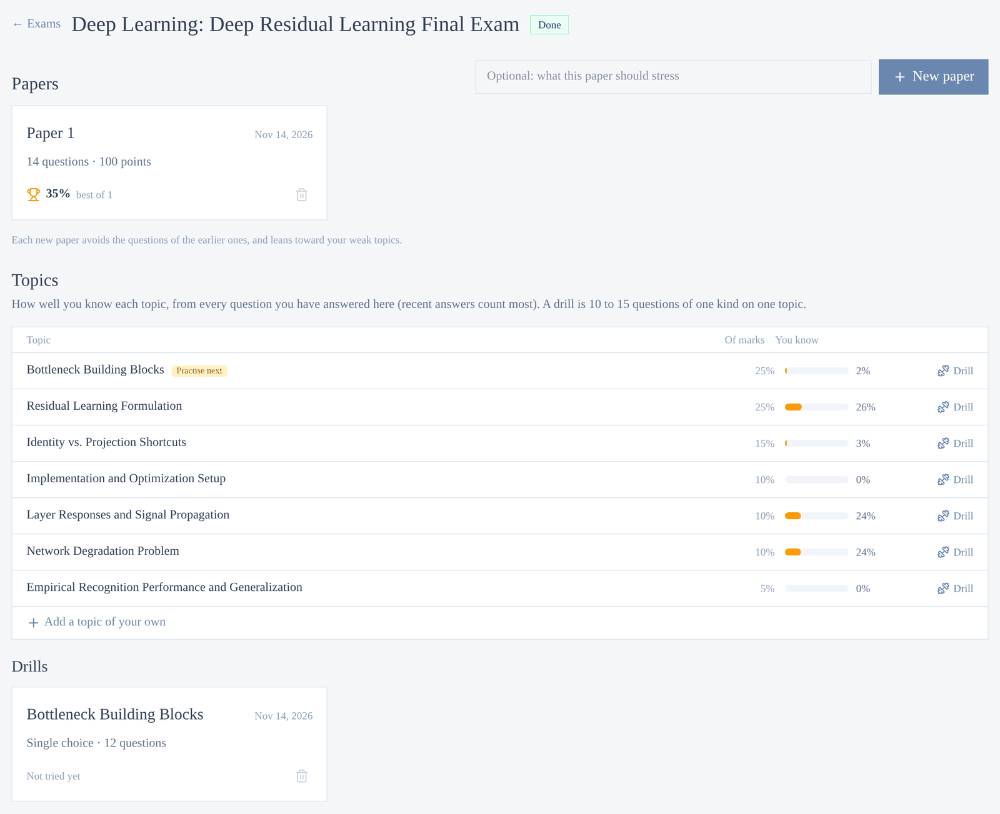
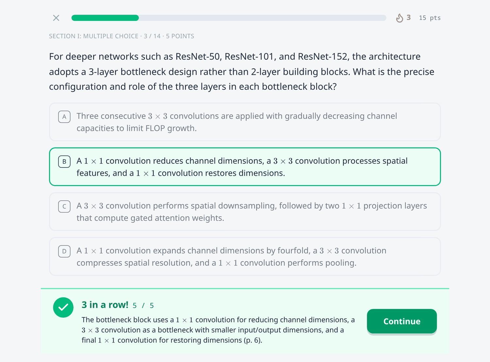
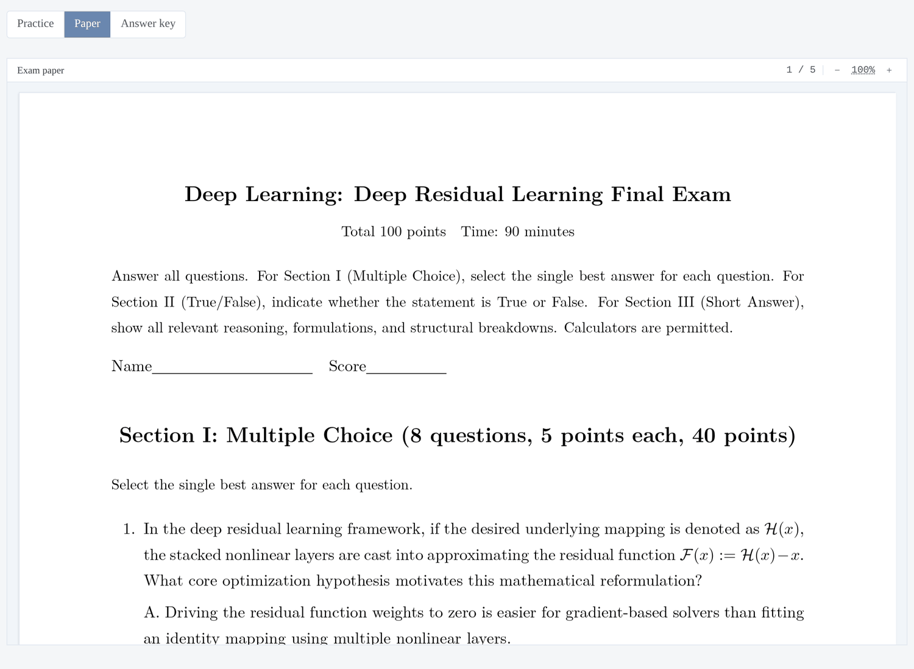
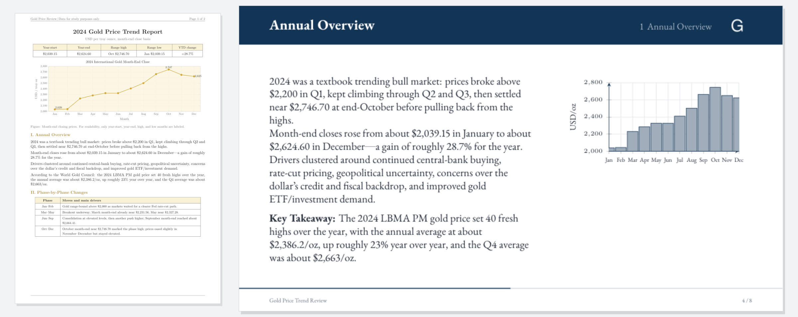
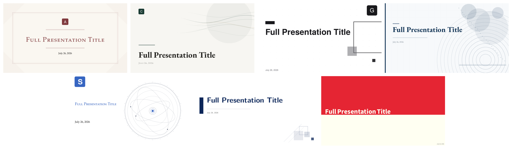

English | [简体中文](README.zh-CN.md)

<h1 align="center">TeXDeck</h1>

<p align="center">
  <b>Drop in a PDF. Study it, drill for the exam, then present it.</b><br>
  Study notes linked to the source, mock exams that adapt to your weak topics, and Beamer decks, all typeset in LaTeX.<br>
  Runs on the ChatGPT, Claude or Gemini plan you already pay for.
</p>

<p align="center">
  <a href="https://github.com/HuanPP/TeXDeck/releases/latest"></a>
  <a href="https://github.com/HuanPP/TeXDeck/releases"></a>
  
  <a href="LICENSE"></a>
  <a href="https://github.com/HuanPP/TeXDeck/stargazers"></a>
</p>

<p align="center">
  <a href="https://github.com/HuanPP/TeXDeck/releases/latest"><b>Download the desktop app</b></a> ·
  <a href="#install">Docker and source</a> ·
  <a href="#pick-a-model">Models</a> ·
  <a href="README.zh-CN.md">简体中文</a>
</p>

<p align="center">
  
</p>

<table>
  <tr>
    <td width="22%"><b>Study notes</b></td>
    <td>A paper or a stack of lecture slides becomes a few pages of boxed notes. Every heading points back to its source page: double-click either side to jump to the other.</td>
  </tr>
  <tr>
    <td width="22%"><b>Ask about any passage</b></td>
    <td>Select a sentence, or drag a box around a figure or table, and ask. Answers cite page numbers, render the maths, and can be written back into the notes.</td>
  </tr>
  <tr>
    <td width="22%"><b>Mock exams</b></td>
    <td>Describe the exam or upload past papers. TeXDeck works out its structure and topics, then writes as many typeset mock papers as you want, each leaning toward what you keep getting wrong.</td>
  </tr>
  <tr>
    <td width="22%"><b>Practise in the browser</b></td>
    <td>One question at a time, marked as you go. Open questions are marked by the model the way your exam marks them. Per-topic mastery tells you what to drill next.</td>
  </tr>
  <tr>
    <td width="22%"><b>Beamer decks</b></td>
    <td>The original TeXDeck: a PDF in, a finished Beamer deck out, in one of seven templates. Click any text on a slide to change it, queue requests, export to PPTX.</td>
  </tr>
</table>

Everything the model writes is LaTeX that compiles on your machine, so you get a real PDF, the `.tex` source, and a zip that opens in Overleaf.

## Learn

### Notes that know where they came from

<p align="center">
  
</p>

Create a notebook from one or more PDFs, or pasted text. The model reads the pages as images, so equations, tables and figures count, and writes compact notes: up to about six pages, one boxed sheet per theme, key terms in bold, examples and asides set apart. Notes follow the language of your material, or English or Chinese if you pick one.

The notebook puts the source on the left and the notes in the middle. Each heading in the notes records the pages it was written from. Double-click a part of the notes and the source scrolls to its page; double-click a source page and the notes scroll to the part that covers it (double-click again to cycle through the others).

The right column is for questions. Select text on either side, or switch on **Area** and drag a box around a figure, and ask. The model sees the notes, the source text and images of the quoted pages, and cites the pages it used. Each question leaves a numbered mark on the page, so you can reopen it later from where you asked it. Open several at once and drag them into any half-column, next to the passage they are about. **Add to notes** turns an answer into an edit request for the right box of the notes; apply it and the notes recompile with the source links intact.

The thin rail at the far left tracks progress. Click a dot when you have learnt a part: it is shaded green in the notes, and a source page is shaded once every part that cites it is done.

### Mock exams that aim at your weak spots

<table>
  <tr>
    <td width="50%"></td>
    <td width="50%"></td>
  </tr>
</table>

Make an exam from the course material and tell it what you know about the real one: a sentence such as "10 multiple choice, 3 short answers, the teacher said bottleneck blocks matter", a table of question types and counts, the time allowed, and up to ten past papers as PDFs or phone photos. The model drafts a profile of the exam (sections, topics and their share of the marks, how questions are asked, how answers are marked) that you can edit before anything is written. Past papers carry the most weight; where your description disagrees with them, your description wins, since it is about this year's exam.

Each **New paper** is a full mock exam typeset in LaTeX, with an answer key, and avoids the questions of the papers before it. Practise it in the browser one question at a time: multiple choice, true or false and fill-in answers are marked on the spot, and short answers and calculations are marked by the model against the exam's marking habits, or by you against the model answer.

Every answer counts toward a per-topic mastery score, with recent answers weighing most. The topic list is sorted by share of marks times what you still don't know, and the top one is flagged **Practise next**. Later papers lean toward your weak topics, and **Drill** writes 10 to 15 questions of one kind on one topic, starting easy and changing one thing at a time. You can add topics of your own, with example questions, for things the material leaves out.

<p align="center">
  
</p>

## Present

<p align="center">
  
</p>

Drop in a PDF and get back a Beamer deck. A vision model reads your pages as images and writes a complete `main.tex` against the template you pick; it takes about a minute.

<p align="center">
  
</p>

After that you can fix wording by clicking it on the slide, and queue requests for any slides or the whole deck, with images attached if you like; they go to the model in one call and compile once. After compiling, slides whose text collides or that run off the page are found and sent back to the model to fix. The model keeps a short memory of your habits and of the mistakes you had to fix, follows it in every new deck, and lets you edit it from the Memory button. Add your own photos, screenshots or logos to the form, with an optional note on where each goes, and the model picks the slide, size and layout for them. Speaker notes come with every deck and land in PowerPoint's notes pane on export.

**Export to PPTX** keeps the text editable: each slide becomes a background image plus text boxes where the text was, set in the closest font your computer actually has. The source on the left above is [`docs/demo/gold-price-2024.pdf`](docs/demo/gold-price-2024.pdf), so you can try it yourself.

<p align="center">
  
</p>

Seven templates are bundled: Academic, Emerald, Graphite, Navy, Scholar, SimplePlus and Execushares. All of them handle Chinese. To restyle one without touching LaTeX, click **New template**: pick the colours, upload a logo, and place any picture as the title-page background, with the sample deck recompiling as you go.

There is no prompt library. Each template's `main.tex` is a complete example deck, and the model copies it. To make your own, copy `templates/academic`, change `key` and `name` in `template.json`, and edit `main.tex`. Real charts in the example mean real charts in the output.

## Install

**Desktop app.** Download it from [Releases](https://github.com/HuanPP/TeXDeck/releases/latest) (macOS Apple silicon, Windows, Linux). It bundles its own TeX engine, so you don't need a TeX install. The builds are unsigned: on macOS, right-click the app and choose Open; on Windows, choose More info, then Run anyway.

**Docker.**

```bash
git clone https://github.com/HuanPP/TeXDeck.git && cd TeXDeck
docker compose up --build        # then open http://localhost:8000
```

**From source.** You need Python 3.12+, Node 20+, and XeLaTeX or [Tectonic](https://tectonic-typesetting.github.io).

```bash
uv venv .venv --python 3.12 && uv pip install -e server --python .venv/bin/python
cp server/.env.example server/.env && ./server/run.sh     # API on :8000
cd web && npm install && npm run dev                      # UI on :5173
```

**On a server, for several people.** Set `TEXDECK_REGISTRATION=true` and sign up first with the invite code `hi_my_texdeck`; that account is the admin and hands out one-use invite links from the Invites menu. Every account connects its own model and sees only its own work. Or add accounts on the server (`python -m app.auth add <username>`). [`docs/deploy`](docs/deploy) has the full setup behind Caddy and Cloudflare, with example service files.

## Pick a model

**No API key needed.** Click the model button in the top bar. It lists four ways to run the model; you can switch between them, and pick the model for each, at any time:

**ChatGPT**, on your ChatGPT plan. Click Connect, sign in, then pick one of the models your account offers.

**Claude**, on your Claude plan. Needs [Claude Code](https://code.claude.com/docs/en/setup) installed on the computer running TeXDeck. If Claude Code is already signed in, Connect is all it takes. Otherwise TeXDeck starts `claude auth login`, shows the sign-in link, and you paste the code from that page back in.

**Antigravity**, on your Google Antigravity plan, through the `agy` CLI. Linux only (see below). Click Connect, sign in on the Google page that opens, and paste the authorization code back within about a minute.

**API key**, for any OpenAI-compatible vision model: enter the key, base URL and model name, e.g. `https://generativelanguage.googleapis.com/v1beta/openai/` with `gemini-pro-latest` (recommended; Kimi vision models also work). Text-only models won't work, because pages are sent as images.

<details>
<summary>How Claude and Antigravity are run, and where settings live</summary>

With Claude, TeXDeck drives your own Claude Code CLI in headless mode (`claude -p`, no tools, CLAUDE.md and plugins off). The login belongs to Claude Code and TeXDeck never sees the credentials; switching away leaves it signed in. Pick Fable, Opus, Sonnet or Haiku in the panel (Sonnet by default); whether your plan includes a model is up to Anthropic, and Claude Code says so if it does not. If `ANTHROPIC_API_KEY` is set in the environment, Claude Code bills the API instead of your plan. The Docker image has no Claude Code, so Claude is for the desktop app and source installs.

agy is a coding agent whose tools cannot be turned off: it reads any file it is pointed at, and with permissive settings it runs commands unasked. A PDF carrying the right instructions could make use of that, so TeXDeck only runs agy inside [bubblewrap](https://github.com/containers/bubblewrap) (`bwrap`), where it sees the system files read-only, its own sign-in and the request's scratch folder, and nothing else. Without `bwrap` (macOS, Windows, the Docker image) Antigravity is not offered. Each account signs in to its own agy home, separate from the agy you use in a terminal. Its input takes text only, so images are handed over as files that the agent opens; that makes it slower than the other options.

The choice and any API key entered there are saved next to the other app data. `.env` (or `texdeck.env` in the desktop app's data folder) can still preset the API key with `TEXDECK_LLM_API_KEY`, `TEXDECK_LLM_BASE_URL` and `TEXDECK_LLM_MODEL`.

</details>

## Good to know

If the model writes TeX that won't compile even after the automatic repair pass, the job fails and shows the real log. You never get a half-broken document. Press Regenerate and it usually works. Slide counts are approximate. Input is limited to 10 PDFs and 200 pages in total.

```bash
cd server && ../.venv/bin/python -m pytest      # includes a real compile of every template
python desktop/build.py                         # build the desktop app for this machine
```

## License

TeXDeck is source-available under the [PolyForm Noncommercial License 1.0.0](LICENSE). Personal, educational and other noncommercial use is free. Commercial use requires a separate license from the author; contact [HuanPP](https://github.com/HuanPP). Releases up to v0.6.1 were published under MIT. Bundled themes and fonts keep their own licenses; see [NOTICE](NOTICE).
