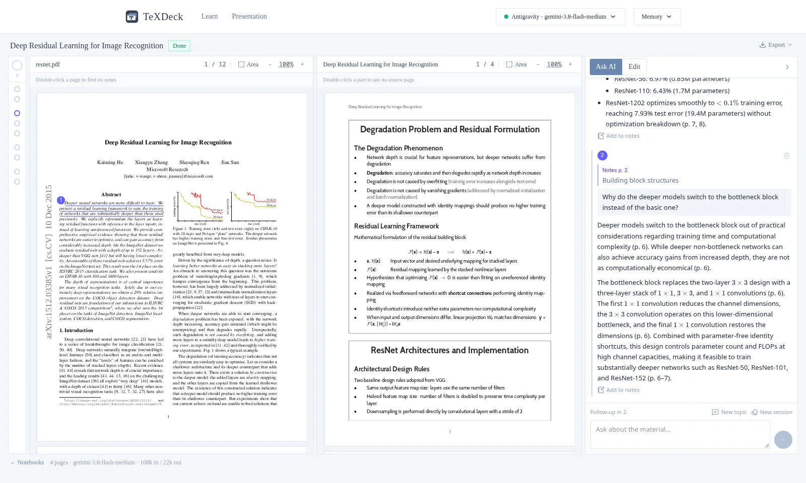
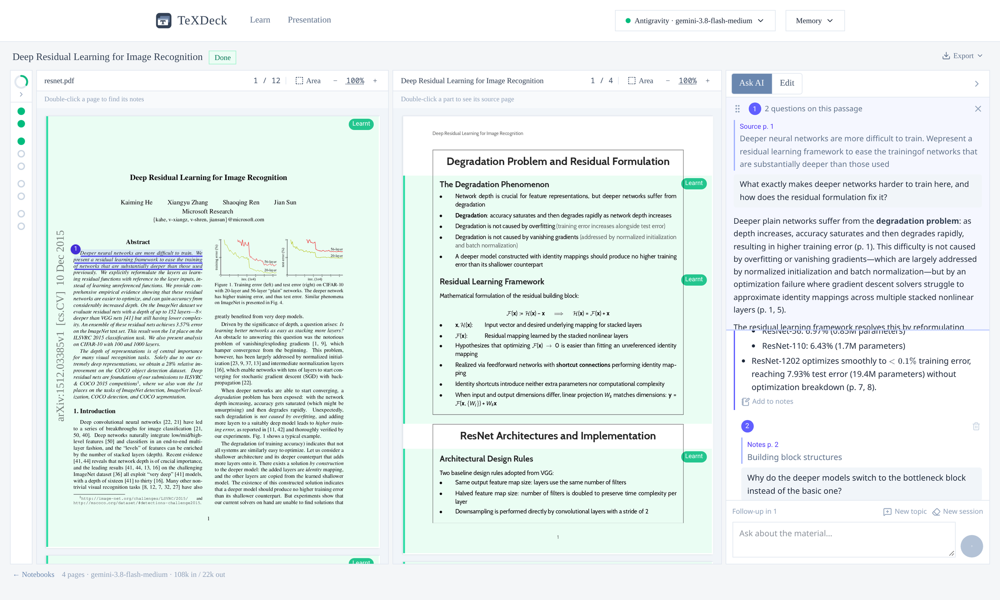
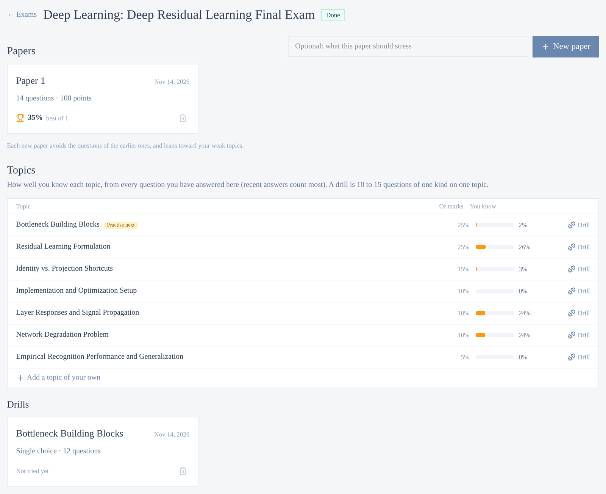
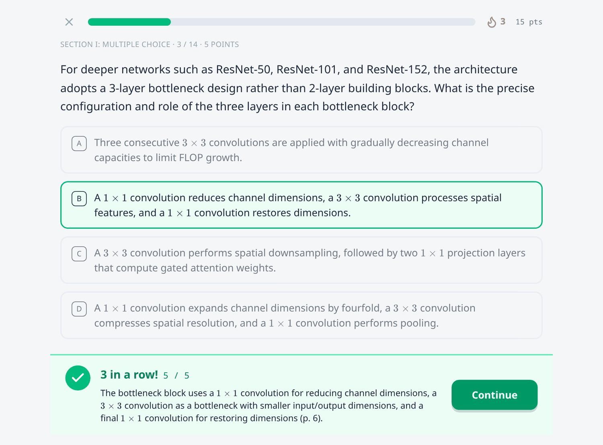
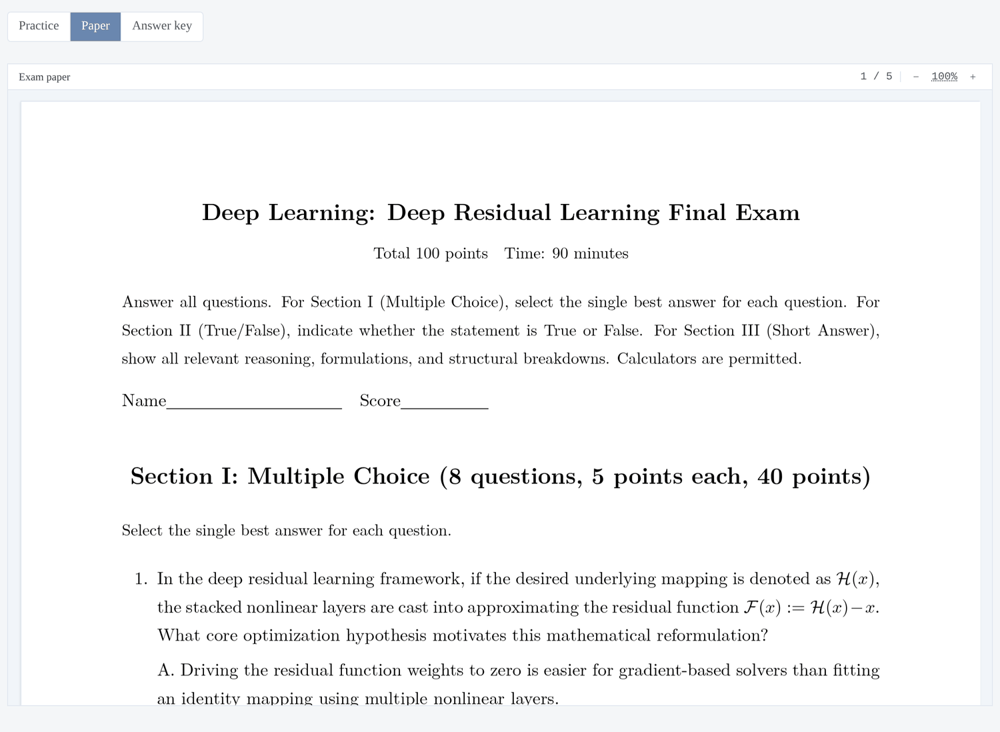
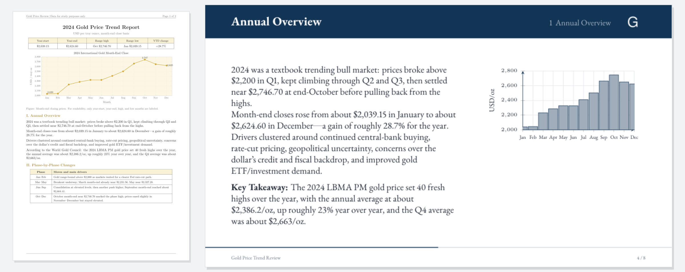
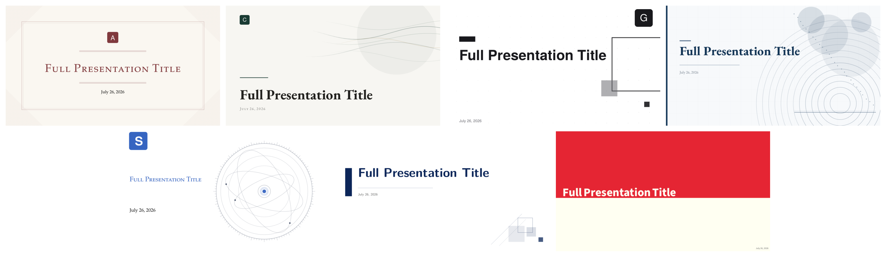
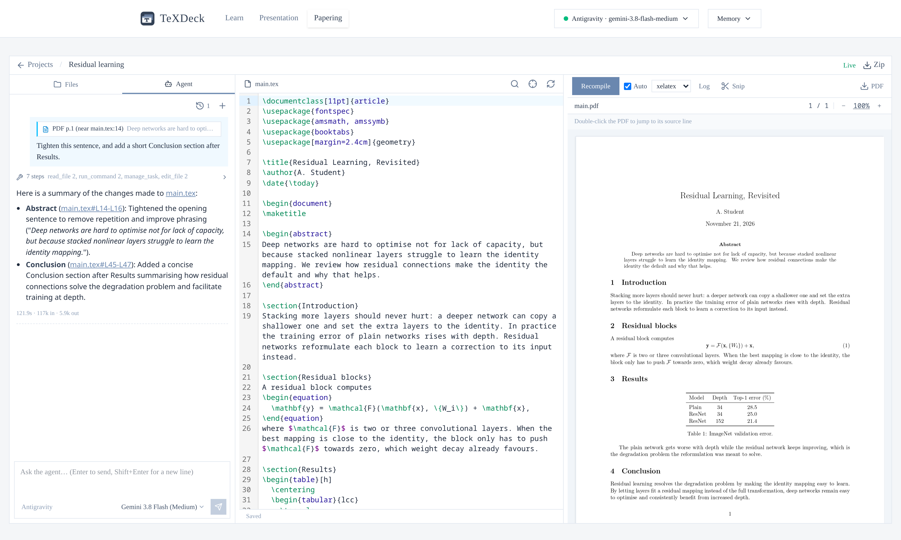

[English](README.md) | 简体中文

<h1 align="center">TeXDeck</h1>

<p align="center">
  <b>放进一份 PDF：读懂它，备考它，再把它讲出来。也可以写你自己的论文。</b><br>
  和原文双向对照的学习笔记、盯着薄弱考点出题的模拟卷、Beamer 幻灯片，以及一个由编程 agent 陪你改稿的 LaTeX 工作区。<br>
  直接用你已经开通的 ChatGPT、Claude 或 Gemini 订阅。
</p>

<p align="center">
  <a href="https://github.com/HuanPP/TeXDeck/releases/latest"></a>
  <a href="https://github.com/HuanPP/TeXDeck/releases"></a>
  
  <a href="LICENSE"></a>
  <a href="https://github.com/HuanPP/TeXDeck/stargazers"></a>
</p>

<p align="center">
  <a href="https://github.com/HuanPP/TeXDeck/releases/latest"><b>下载桌面版</b></a> ·
  <a href="#安装">Docker 与源码运行</a> ·
  <a href="#选模型">选模型</a> ·
  <a href="README.md">English</a>
</p>

<p align="center">
  
</p>

<table>
  <tr>
    <td width="22%"><b>学习笔记</b></td>
    <td>一篇论文或一叠课件变成几页带框的笔记。每个标题都记着出处页码，双击任意一边就跳到另一边对应的位置。</td>
  </tr>
  <tr>
    <td width="22%"><b>对任意段落提问</b></td>
    <td>选中一句话，或者框住一张图、一个表格，直接提问。回答标注页码、正常渲染公式，还能一键写回笔记。</td>
  </tr>
  <tr>
    <td width="22%"><b>模拟考试</b></td>
    <td>描述一下考试，或者上传往年题。TeXDeck 先摸清考试的结构和考点，再出任意多张排版好的模拟卷，每张都偏向你总做错的部分。</td>
  </tr>
  <tr>
    <td width="22%"><b>在浏览器里刷题</b></td>
    <td>一题一题做，做完即判。主观题由模型按这门考试的评分习惯打分。每个考点的掌握度告诉你下一步该练什么。</td>
  </tr>
  <tr>
    <td width="22%"><b>Beamer 幻灯片</b></td>
    <td>TeXDeck 的老本行：放进 PDF，拿回一套完整的 Beamer，七套模板可选。点幻灯片上的字就能改，修改要求可以攒着一起提，还能导出 PPTX。</td>
  </tr>
  <tr>
    <td width="22%"><b>写论文</b></td>
    <td>一个 LaTeX 项目，编辑器旁边就是 PDF，再配上直接改文件的 Claude Code、Codex 或 Antigravity。可以把源码或 PDF 里的一句话指给 agent，也可以框选页面上的一块区域发给它。</td>
  </tr>
</table>

模型写出的一切都是在你本机编译的 LaTeX：拿到的是真正的 PDF、`.tex` 源码，以及能直接导入 Overleaf 的 zip。

## 学习

### 知道自己出自哪一页的笔记

<p align="center">
  
</p>

用一份或多份 PDF（也可以粘贴文字）新建笔记本。模型把页面当图片读，公式、表格和插图都算在内，写出紧凑的笔记：最多约六页，一个主题一个框，关键词加粗，例子和旁注单独排开。笔记语言默认跟随材料，也可以指定中文或英文。

笔记本左边是原文，中间是笔记。笔记里每个标题都记着它依据的原文页码：双击笔记的某一部分，原文翻到对应页；双击原文某一页，笔记滚到讲这一页的部分，再双击会依次切换到其他相关部分。

右栏用来提问。在任意一边选中文字，或者打开 **Area** 框住一张图，然后提问。模型能看到笔记、原文文字和被引页面的图片，回答里标出用到的页码。每个问题会在页面上留下一个编号，之后点它就能从提问的位置重新打开。可以同时打开多个问题卡片，拖到任意半栏，放在它所讲的段落旁边。**Add to notes** 把一条回答变成对笔记相应框的修改请求，应用后笔记重新编译，出处标注照样保留。

最左边的细栏记录进度。学完一部分就点一下对应的小点：笔记上这部分罩成浅绿色；某页原文被引用的部分全部学完后，这一页也会整页罩色。

### 专攻薄弱点的模拟考试

<table>
  <tr>
    <td width="50%"></td>
    <td width="50%"></td>
  </tr>
</table>

用课程材料新建一场考试，再把你对真实考试的了解告诉它：一句话描述（例如“10 道单选、3 道简答，老师说瓶颈结构是重点”）、题型与题量表、考试时长，以及最多十份往年题，PDF 或手机拍照都行。模型先起草一份考试画像：分几部分、有哪些考点及各自的分值占比、题目怎么问、答案怎么评分。出题之前你可以修改它。往年题的权重最高；你的描述和往年题冲突时以描述为准，因为它说的是今年的考试。

每点一次 **New paper** 就得到一整张 LaTeX 排版的模拟卷和答案，并且避开之前各卷出过的题。可以在浏览器里一题一题地练：选择、判断、填空当场判分，简答和计算由模型按这门考试的评分习惯打分，也可以对照参考答案自己评。

每道题的得分都计入对应考点的掌握度，越近的作答权重越高。考点列表按“分值占比 × 尚未掌握的程度”排序，排第一的标为 **Practise next**。之后出的卷子会偏向你的薄弱考点；**Drill** 针对一个考点出 10 到 15 道同一题型的题，由浅入深，每题只变一处。材料里没覆盖的内容，可以自己加考点并附上例题。

<p align="center">
  
</p>

## 演示

<p align="center">
  
</p>

丢进一份 PDF，拿回一套 Beamer。视觉模型把页面当图片读，按你选的模板写出完整的 `main.tex`，一分钟左右出结果。

<p align="center">
  
</p>

之后可以在幻灯片上点击文字直接改字，也可以给任意几页或整套提修改要求（可以附图或直接粘贴截图），攒齐后一次交给模型、只编译一次。编译后会自动找出文字互相压住或超出页面的页，交回模型修正。模型还会记住你的习惯和你改过的常见错误，之后每次生成都照着做，记忆内容可以在顶栏的 Memory 里随时修改。表单里可以加入自己的照片、截图或 logo，每张可附一句放在哪里的备注，由模型决定放在哪一页、多大、怎样排版。每套幻灯片都带演讲者备注，导出 PPTX 时写进 PowerPoint 的备注栏。

**导出 PPTX** 后文字仍可编辑：每页是一张背景图加上原位置的文本框，字体选你电脑上实际装有的最接近的一款。上图左侧的源文件是 [`docs/demo/gold-price-2024.pdf`](docs/demo/gold-price-2024.pdf)，可以自己跑一遍。

<p align="center">
  
</p>

内置七套模板：Academic、Emerald、Graphite、Navy、Scholar、SimplePlus、Execushares，都支持中文。不写 LaTeX 也能改出自己的样式：点 **New template**，改配色、上传 logo，把任意图片放到标题页背景上，示例幻灯片边改边重新编译。

项目里没有提示词库。每套模板的 `main.tex` 都是一套完整的示例幻灯片，模型照着它写。做自己的模板：复制 `templates/academic`，改 `template.json` 里的 `key` 和 `name`，再改 `main.tex`。示例里放真图表，生成结果里就有真图表。

## 写作

<p align="center">
  
</p>

**Papering** 是一个 LaTeX 工作区：左边文件，中间编辑器，右边 PDF，三栏可以拖动调宽，窄屏时变成标签页。可以从空白文章（中文或英文）开始，也可以导入 zip，比如从 Overleaf 下载的项目。停止输入片刻后项目自动重新编译；出错时显示文件和行号，PDF 保留上一次成功的版本。双击 PDF 跳到对应的源码行，点准星按钮则从光标所在行跳到 PDF。PDF 和整个项目的 zip 都能下载。

Agent 标签页在项目上运行一个编程 agent：Claude Code、Codex、Antigravity，或者经 Claude Code、Codex 调用的 API key。它直接改项目文件，编辑器里实时显示每处改动，agent 结束后项目自动重新编译。想让它看某处内容，在编辑器或 PDF 里选中文字后点 **Add to chat**，或者点 **Snip** 在 PDF 上框住一张图或一个公式；这段内容会以卡片形式随消息发出，卡片注明出处，精确到源码行。连续的工具调用折叠成一行，点开能看到每一步。会话保留历史记录，下次接着上次的上下文继续；同一个项目同一时间只有一个 agent 在工作。

隔离程度取决于在哪里运行。在 Linux 服务器上，TeXDeck 在 [bubblewrap](https://github.com/containers/bubblewrap) 里编译，断网且禁止 shell escape；agent 运行在 bubblewrap 加 [pasta](https://passt.top) 里，只能看到项目和它自己的登录，连不到内网地址和云主机元数据服务。桌面版没有这层沙箱：装了 TeX（latexmk）就用你的 TeX，没装就用自带的 Tectonic，agent 命令行直接在你的电脑上启动，和你在终端里运行它一样。TeXDeck 会要求 agent 只在项目目录里活动，但没有手段强制，所以请按在终端里使用 Claude Code、Codex 的信任程度来用它。Antigravity 只在 Linux 服务器上提供，原因见[选模型](#选模型)。Codex 在面板里用设备码登录，Claude Code 沿用它自己的登录。

## 安装

**桌面版**：从 [Releases](https://github.com/HuanPP/TeXDeck/releases/latest) 下载（macOS Apple 芯片、Windows、Linux），自带 TeX 引擎，不用另装 TeX。安装包没有签名：macOS 上右键选“打开”，Windows 上点“更多信息”，再点“仍要运行”。

**Docker**：

```bash
git clone https://github.com/HuanPP/TeXDeck.git && cd TeXDeck
docker compose up --build        # 然后打开 http://localhost:8000
```

不开账号时，镜像用自带的 TeX Live 编译 Papering 项目；开了注册以后，Papering 必须走 bubblewrap 沙箱，而容器里跑不了它。镜像里也没有装任何 agent 命令行。

**源码运行**：需要 Python 3.12+、Node 20+，以及 XeLaTeX 或 [Tectonic](https://tectonic-typesetting.github.io)。Papering 还需要 latexmk；在服务器上，它的沙箱需要 `bwrap`、`pasta`（Debian 包名 `passt`）和 `ip`。

```bash
uv venv .venv --python 3.12 && uv pip install -e server --python .venv/bin/python
cp server/.env.example server/.env && ./server/run.sh     # API 在 :8000
cd web && npm install && npm run dev                      # 界面在 :5173
```

**部署到服务器，多人共用**：设 `TEXDECK_REGISTRATION=true`，先用邀请码 `hi_my_texdeck` 注册第一个账号，它就是管理员，之后在 Invites 菜单里复制一次性的邀请链接发给别人。每个账号连接自己的模型，只看得到自己的内容。也可以在服务器上直接建账号（`python -m app.auth add <用户名>`）。[`docs/deploy`](docs/deploy) 里有放在 Caddy 和 Cloudflare 后面的完整做法和示例配置文件。

## 选模型

**不需要 API key。** 点顶栏的模型按钮，面板里列出四种用法，随时可以切换，也可以分别选择模型：

**ChatGPT**：用你的 ChatGPT 订阅，点 Connect 登录，再从账号可用的模型里选一个。

**Claude**：用你的 Claude 订阅。运行 TeXDeck 的电脑上要装有 [Claude Code](https://code.claude.com/docs/en/setup)。Claude Code 已经登录的话，点 Connect 就能用；没登录的话，TeXDeck 会启动 `claude auth login` 并显示登录链接，授权后把页面给出的代码粘贴回来。

**Antigravity**：用你的 Google Antigravity 订阅，经 `agy` 命令行调用，只支持 Linux（见下文）。点 Connect，在打开的 Google 页面登录，一分钟内把授权码粘贴回来。

**API key**：任意 OpenAI 兼容的视觉模型，填入 key、Base URL 和模型名，例如 `https://generativelanguage.googleapis.com/v1beta/openai/` 配 `gemini-pro-latest`（推荐；Kimi 的 vision 模型也能用）。纯文本模型用不了，因为页面是以图片形式发给模型的。

<details>
<summary>Claude 和 Antigravity 怎样运行，设置存在哪里</summary>

用 Claude 时，TeXDeck 以无头模式驱动你本机的 Claude Code（`claude -p`，不开工具，不加载 CLAUDE.md 和插件）。登录状态归 Claude Code 管，TeXDeck 接触不到凭据，切换到别的方式也不会让它退出登录。模型在面板里选 Fable、Opus、Sonnet 或 Haiku，默认 Sonnet；订阅是否包含某个模型由 Anthropic 决定，不包含时 Claude Code 会直接报错说明。环境里设了 `ANTHROPIC_API_KEY` 的话，Claude Code 会改走 API 计费。Docker 镜像里没有 Claude Code，Claude 只适用于桌面版和源码运行。

agy 是一个工具关不掉的编程 agent：它能读任何被指到的文件，配置宽松时还会自行执行命令，夹带指令的 PDF 可以利用这一点。所以 TeXDeck 只在 [bubblewrap](https://github.com/containers/bubblewrap)（`bwrap`）沙箱里运行 agy，它只能看到只读的系统文件、自己的登录和本次请求的临时目录。没有 `bwrap` 的环境（macOS、Windows、Docker 镜像）不提供 Antigravity。每个账号各自登录一份独立的 agy，与你在终端里用的 agy 互不相干。它的输入只接受文字，图片以文件形式交给 agent 自己打开，因此比其他方式慢。

面板里的选择和填入的 API key 会保存在应用数据目录。也仍然可以在 `.env`（桌面版是数据目录的 `texdeck.env`）里用 `TEXDECK_LLM_API_KEY`、`TEXDECK_LLM_BASE_URL`、`TEXDECK_LLM_MODEL` 预设 API key。

</details>

## 须知

模型写出的 TeX 如果经过自动修复仍然编译不过，任务会直接失败并给出真实日志，不会交出半残的文档。点 Regenerate 重跑一般就能成功。幻灯片页数要求只是参考。输入上限为 10 份 PDF、合计 200 页。

```bash
cd server && ../.venv/bin/python -m pytest      # 含每套模板的真实编译
python desktop/build.py                         # 为本机打包桌面版
```

## 许可证

TeXDeck 采用 [PolyForm Noncommercial License 1.0.0](LICENSE)，源码公开。个人、教学及其他非商业用途免费；商业用途须另行取得作者授权，请联系 [HuanPP](https://github.com/HuanPP)。v0.6.1 及以前的版本以 MIT 发布。内置主题和字体各自保留原许可证，见 [NOTICE](NOTICE)。
