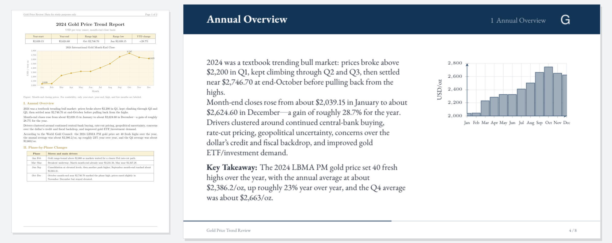
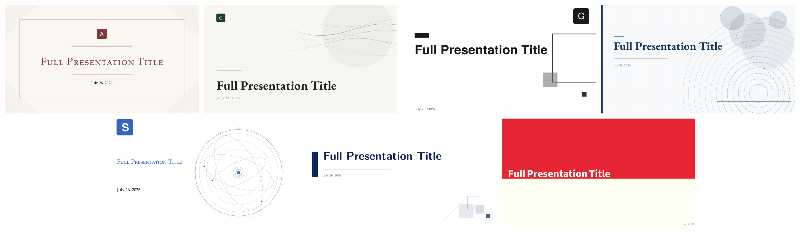

[English](README.md) | 简体中文

# TeXDeck

<p align="center">
  
</p>

丢进一份 PDF，拿回一套 Beamer：编译好的 PDF、`.tex` 源码，以及能直接导入 Overleaf 的 zip。

<p align="center">
  
</p>

视觉模型把页面当图片读，按你选的模板写出完整的 `main.tex`，一分钟左右出结果。之后可以用一句话改某一页，也可以改整套。左图的源文件是 [`docs/demo/gold-price-2024.pdf`](docs/demo/gold-price-2024.pdf)，可以自己跑一遍。幻灯片语言默认跟随材料，也可以在表单里指定中文或英文。表单里还可以加入自己的照片、截图或 logo，每张可附一句放在哪里的备注，由模型决定放在哪一页、多大、怎样排版。

**不需要 API key**：直接用你已经开通的 ChatGPT 或 Claude 订阅，也支持 API key。

## 安装

**桌面版**：从 [Releases](https://github.com/HuanPP/TeXDeck/releases) 下载（macOS Apple 芯片、Windows、Linux），自带 TeX 引擎，不用另装 TeX。安装包没有签名：macOS 上右键选“打开”，Windows 上点“更多信息”，再点“仍要运行”。

**Docker**：

```bash
git clone https://github.com/HuanPP/TeXDeck.git && cd TeXDeck
docker compose up --build        # 然后打开 http://localhost:8000
```

**源码运行**：需要 Python 3.12+、Node 20+，以及 XeLaTeX 或 [Tectonic](https://tectonic-typesetting.github.io)。

```bash
uv venv .venv --python 3.12 && uv pip install -e server --python .venv/bin/python
cp server/.env.example server/.env && ./server/run.sh     # API 在 :8000
cd web && npm install && npm run dev                      # 界面在 :5173
```

**部署到服务器**：设 `TEXDECK_REGISTRATION=true`，先用邀请码 `hi_my_texdeck` 注册第一个账号，它就是管理员，之后由管理员发一次性邀请码；每个账号连接自己的 ChatGPT、Claude 或 API key。也可以在服务器上直接建账号（`python -m app.auth add <用户名>`）。两种方式下页面都会要求登录，没有登录的请求一律被接口拒绝。[`docs/deploy`](docs/deploy) 里有放在 Caddy 和 Cloudflare 后面的完整做法和示例配置文件。

## 选模型

点顶栏的模型按钮，面板里列出四种用法，随时可以切换，也可以分别选择模型：

**ChatGPT**：用你的 ChatGPT 订阅，点 Connect 登录，再从账号可用的模型里选一个。

**Claude**：用你的 Claude 订阅。运行 TeXDeck 的电脑上要装有 [Claude Code](https://code.claude.com/docs/en/setup)。Claude Code 已经登录的话，点 Connect 就能用；没登录的话，TeXDeck 会启动 `claude auth login` 并显示登录链接，授权后把页面给出的代码粘贴回来。

**Antigravity**：用你的 Google Antigravity 订阅，经 `agy` 命令行调用，只支持 Linux（见下文）。点 Connect，在打开的 Google 页面登录，一分钟内把授权码粘贴回来。

**API key**：任意 OpenAI 兼容的视觉模型，填入 key、Base URL 和模型名，例如 `https://generativelanguage.googleapis.com/v1beta/openai/` 配 `gemini-pro-latest`（推荐；Kimi 的 vision 模型也能用）。纯文本模型用不了，因为页面是以图片形式发给模型的。

用 Claude 时，TeXDeck 以无头模式驱动你本机的 Claude Code（`claude -p`，不开工具，不加载 CLAUDE.md 和插件）。登录状态归 Claude Code 管，TeXDeck 接触不到凭据，切换到别的方式也不会让它退出登录。模型在面板里选 Fable、Opus、Sonnet 或 Haiku，默认 Sonnet；订阅是否包含某个模型由 Anthropic 决定，不包含时 Claude Code 会直接报错说明。环境里设了 `ANTHROPIC_API_KEY` 的话，Claude Code 会改走 API 计费。Docker 镜像里没有 Claude Code，Claude 只适用于桌面版和源码运行。

agy 是一个工具关不掉的编程 agent：它能读任何被指到的文件，配置宽松时还会自行执行命令，夹带指令的 PDF 可以利用这一点。所以 TeXDeck 只在 [bubblewrap](https://github.com/containers/bubblewrap)（`bwrap`）沙箱里运行 agy，它只能看到只读的系统文件、自己的登录和本次请求的临时目录。没有 `bwrap` 的环境（macOS、Windows、Docker 镜像）不提供 Antigravity。每个账号各自登录一份独立的 agy，与你在终端里用的 agy 互不相干。它的输入只接受文字，图片以文件形式交给 agent 自己打开，因此比其他方式慢。

面板里的选择和填入的 API key 会保存在应用数据目录。也仍然可以在 `.env`（桌面版是数据目录的 `texdeck.env`）里用 `TEXDECK_LLM_API_KEY`、`TEXDECK_LLM_BASE_URL`、`TEXDECK_LLM_MODEL` 预设 API key。

## 模板

<p align="center">
  
</p>

内置七套模板：Academic、Emerald、Graphite、Navy、Scholar、SimplePlus、Execushares，都支持中文，许可证见 [NOTICE](NOTICE)。

不写 LaTeX 也能改出自己的样式：点 New template（或在 Academic、Emerald、Graphite、Navy、Scholar 上点调色板图标）。编辑器边改边重新编译示例幻灯片，可以改配色、上传 logo，并把任意图片放到标题页背景上：在 16:9 页面里拖动、缩放、拉伸、旋转，空白处用模糊图、纯色或原背景填充。保存的模板按账号隔离，只存改动部分，版式仍来自内置模板。

项目里没有提示词库。每套模板的 `main.tex` 都是一套完整的示例幻灯片，模型照着它写。做自己的模板：复制 `templates/academic`，改 `template.json` 里的 `key` 和 `name`，再改 `main.tex`。示例里放真图表，生成结果里就有真图表。

## 须知

模型写出的 TeX 如果经过自动修复仍然编译不过，任务会直接失败并给出真实日志，不会交出半残的幻灯片。点 Regenerate 重跑一般就能成功。页数要求只是参考。输入上限为 10 份 PDF、合计 200 页。

```bash
cd server && ../.venv/bin/python -m pytest      # 含每套模板的真实编译
python desktop/build.py                         # 为本机打包桌面版
```

## 许可证

应用代码采用 MIT。内置主题各自保留原许可证，见 [NOTICE](NOTICE)。
