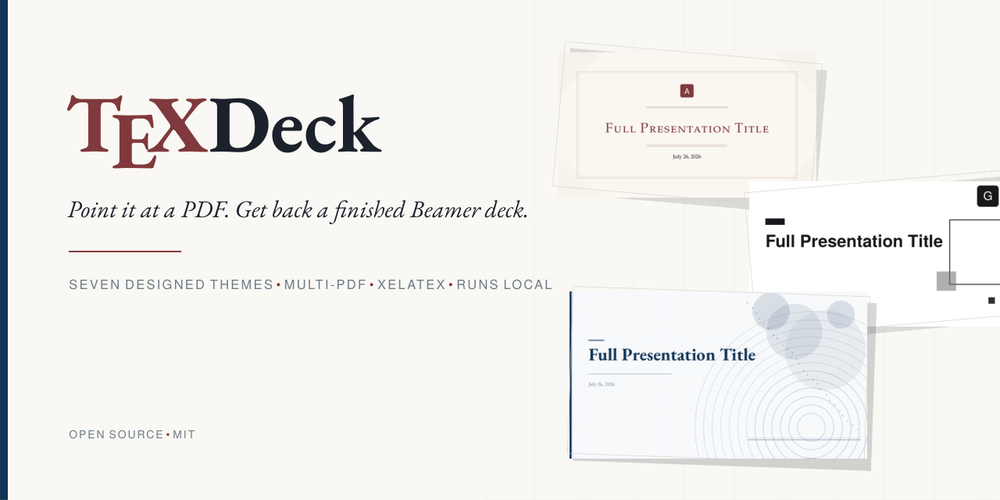
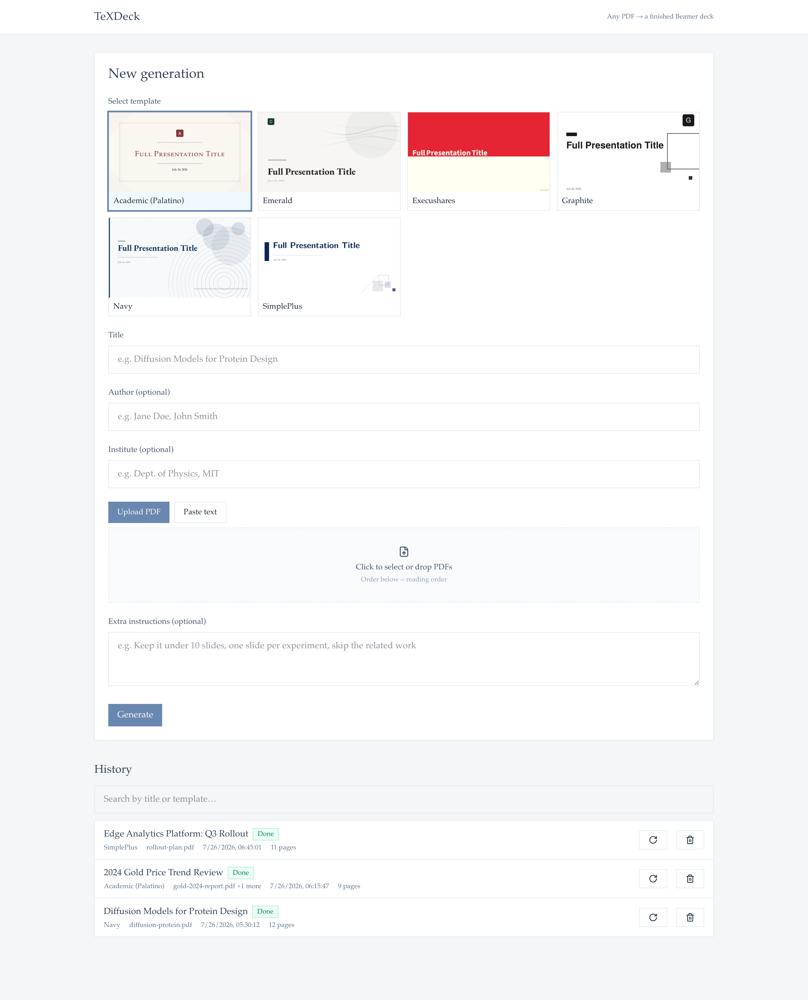

[English](README.md) | 简体中文

# TeXDeck

丢给它一份 PDF，拿回一套写完的 Beamer。

<p align="center">
  
</p>

组会汇报、会议 talk、开题答辩、课题进展。你也可以拿季报去试，它不会拒绝，但科研工作里的幻灯片才是它围绕着做出来的。

<p align="center">
  
</p>

你上传一篇论文——或者好几份 PDF，按顺序当一摞材料读——或者直接粘贴文本，选一套模板，视觉模型读页图，按该模板写出完整的 `main.tex`，再由 XeLaTeX 编译。大约三十到六十秒后，你得到 PDF、背后的 `.tex`，以及一个可以直接丢进 Overleaf 的 zip。无论源文档什么语言，幻灯片默认用英文写；想要中文（或任何语言），在附加要求里说一句即可。

## 七套模板

<p align="center">
  
</p>

| Key | Name | Origin | License |
|---|---|---|---|
| `academic` | Academic (Palatino) | collegeBeamer derivative | CC BY 4.0 |
| `emerald` | Emerald | collegeBeamer derivative | CC BY 4.0 |
| `graphite` | Graphite | collegeBeamer derivative | CC BY 4.0 |
| `navy` | Navy | collegeBeamer derivative | CC BY 4.0 |
| `scholar` | Scholar | collegeBeamer derivative | CC BY 4.0 |
| `simpleplus` | SimplePlus | [pm25/SimplePlus-BeamerTheme](https://github.com/pm25/SimplePlus-BeamerTheme) | Unlicense |
| `execushares` | Execushares | [hamaluik/Beamer-Theme-Execushares](https://github.com/hamaluik/Beamer-Theme-Execushares) | MIT |

collegeBeamer 一脉虽同源，如今已是各自独立的版式家族：Academic 是大学出版社的书籍扉页风（双细线框、居中小型大写、罗马数字节页）；Emerald 是杂志编辑风（大号衬线展示标题、流线纹理、带幽灵数字的满幅章节页）；Graphite 是瑞士排印风（Heros 无衬线、硬网格、单色图表）；Navy 是董事会报告风（藏青通栏题头带、左右分栏议程页、页脚进度线）；Scholar 保留了这一脉原始的构图——标题块旁一整幅版画式插图。SimplePlus 与 Execushares 保持各自上游的身份。七套都能在干净的 TeX Live 上用 XeLaTeX 编译，主题所需字体随包自带或按名解析自 TeX Live；每套都支持中文输入。没有一套自带别人的 logo——`src/brand/` 下的图是中性占位，本来就打算被替换掉。

## 模板文件本身就是提示词

这是整个项目立在上面的那一个想法。值得说清楚，因为它解释了为什么代码里少了那么多本可以堆上去的东西。

每套模板目录里都有一份 `main.tex`：完整、可编译的演示文稿——标题页、目录、各布局的实作范例、真的 `pgfplots` 图，以及文首一段写给模型看的注释。这份文件原样交给模型。旁边没有规则清单，没有样式 DSL，没有 prompt 库。模型被展示的是一套看起来对的幻灯片，然后被要求再写一套。

改模板之前，有个后果值得先知道。当布局范例里放的是一个空框、标题写着「此处放图」，生成出来的每一套就都带着一个空框，标题换成当次的主题。当某一页该放图的地方放了文字，模型就自己发明了一个 `\includegraphics`，指向一个并不存在的文件。这两件事都不是加指令解决的；都是把范例改对才解决的。模型并没有违抗——它在准确地抄它所看到的东西。模板里放真图，回来的就是真图。

这个想法的上一版走了反方向。它长到大约 3.1 万行、82 条路由，还有一条五级流水线：先摘要 PDF，再摘要摘要，再截断以塞进 prompt 预算。真正到达模型的，大约是每份文档 2.2KB 文本。它在自己的指标上分数不错，做出的幻灯片却没人想用。TeXDeck 是对那条路的反应：把交给模型的东西保持诚实，并把代码保持到「交接本身就是产品」的规模。

同一直觉还推出两条更小的规矩。源页面以图片交给模型，中间不做摘要，也不静默截断。而当事情失败时——模型返回了不可用的 TeX，或 XeLaTeX 在允许的修复次数后仍编不过——任务就带着真实错误失败。没有兜底幻灯片。

## 快速开始

最省事的是 Docker——除了一个 API 密钥什么都不用装：

```bash
git clone https://github.com/HuanPP/TeXDeck.git && cd TeXDeck
cat > .env <<'ENV'
TEXDECK_LLM_API_KEY=你的密钥
# 任何 OpenAI 兼容的视觉模型端点都可以；以下是默认值：
TEXDECK_LLM_BASE_URL=https://generativelanguage.googleapis.com/v1beta/openai/
TEXDECK_LLM_MODEL=gemini-pro-latest
ENV
docker compose up --build
```

首次构建要下载 TeX Live，耐心一点；之后打开 http://localhost:8000 即可。生成的 deck 落在 `./artifacts`。镜像内置 Noto CJK，中文输出开箱就是思源字体。

### 从源码运行

你需要 Python 3.12+、Node 20+、带 XeLaTeX 的 TeX Live 安装（若要用单页编辑，还需要 `synctex`），以及一个支持视觉的模型 API 密钥。

```bash
git clone https://github.com/HuanPP/TeXDeck.git && cd TeXDeck

uv venv .venv --python 3.12
uv pip install -e server --python .venv/bin/python

cp server/.env.example server/.env   # then set TEXDECK_LLM_API_KEY
./server/run.sh                      # API on :8000
```

另开一个终端：

```bash
cd web && npm install && npm run dev  # UI on :5173
```

<p align="center">
  
</p>

模型必须能读图——PDF 页是以渲染图送进去的，不是抽出来的文字。任何兼容 OpenAI 协议的端点都可以；把 `TEXDECK_LLM_BASE_URL` 指过去即可。

如果你有密钥，推荐 Gemini。它的多模态阅读在这里可选的几家里最好，也能扛住一长串页图而不丢线：

```
TEXDECK_LLM_BASE_URL=https://generativelanguage.googleapis.com/v1beta/openai/
TEXDECK_LLM_MODEL=gemini-pro-latest
```

`gemini-pro-latest` 是一个别名，始终指向 Google 当前的 Pro 模型，所以这份配置不会随着新模型发布而过期。如果你希望它永远不变，改成固定版本即可（`gemini-2.5-pro`、`gemini-3.1-pro-preview`）。

Moonshot 的 Kimi 也能用，本项目就是对着它开发的：

```
TEXDECK_LLM_BASE_URL=https://api.moonshot.cn/v1
TEXDECK_LLM_MODEL=moonshot-v1-128k-vision-preview
```

两样行不通的东西：纯文本模型，以及 Moonshot 的 `kimi-k2.6` / `kimi-k3` 系列——它们除了 temperature=1 之外一概拒绝，因而拒掉本项目发出的调用。

## 做成自己的

把 `templates/academic` 复制为 `templates/mylab`，改掉其中 `template.json` 的 `key` 与 `name`，再把你的 logo 和背景覆盖进 `src/brand/` 下那三张占位图。重启服务，选择器里就会出现你的模板。

如果想让它看起来完全是另一回事，去改 `main.tex`——布局、颜色、范例、文首那段告诉模型该做什么的注释。你放进这个文件的东西，就是模型会去模仿的东西，所以范例值得做好。扩展机制就是这些；没有别的要学。

## 值得知道的事

生成可能失败。模型偶尔会写出编不过的 LaTeX——多一格的表格行是经典例子——虽然有自动修复，但不总能修好。那种时候你拿到的是错误和编译日志，而不是半残的幻灯片。再跑一次通常就过了——Regenerate 按钮一键复用同样的输入重跑。更好的模型失败更少。

编辑有两个粒度。逐页编辑按一条指令重写一页；整稿精修按一条指令处理整套——"压到十页""图表放大""改成中文"——走同一套校验-编译-修复机器，编不过就整体回滚。

页数是请求，不是保证。你要八页，经常会得到十页。

PDF 合计上限 200 页，一次最多十个文件。超过 40 页时，模型会先看到全部材料的缩略图，并被要求指出哪些页承载论证；只有那些页会以全分辨率送入。

单页编辑用 synctex 把 PDF 页映射回对应的 `\begin{frame}`。若 TeX 安装里没有 synctex，该功能会明确告诉你，而不是靠猜。

## 测试

```bash
cd server && ../.venv/bin/python -m pytest      # includes a real XeLaTeX compile of every template
cd server && ../.venv/bin/python -m pytest -m "not slow"
```

值得保留的是那套编译测试。它用真实工具链渲染每一套内置模板——也只有这一关能抓住某套模板悄无编不过了的情况。

## 许可证

应用代码为 MIT。内置主题各自带有许可证与归属说明——再分发前请看 [NOTICE](NOTICE)。
